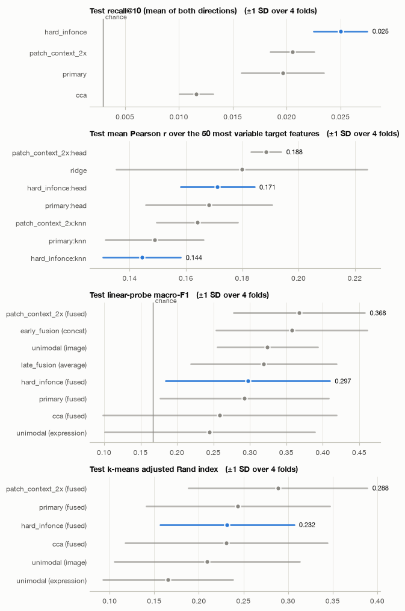
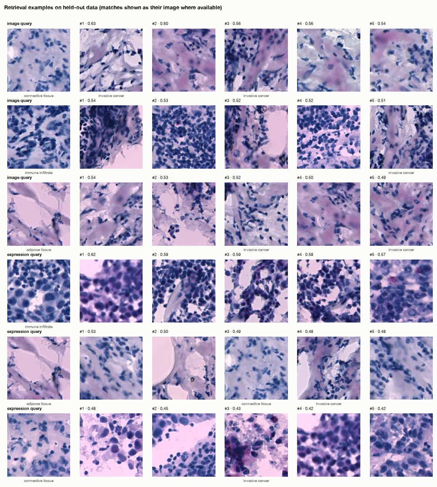
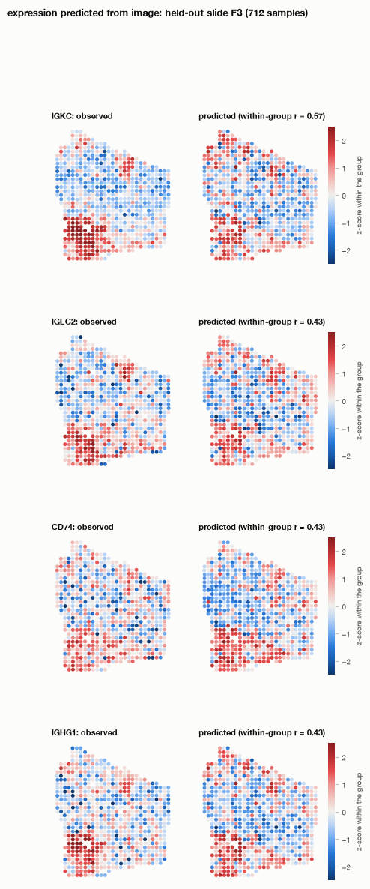
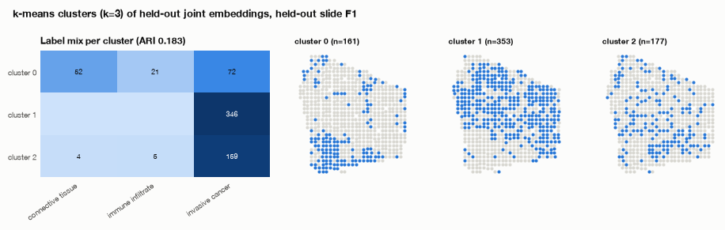
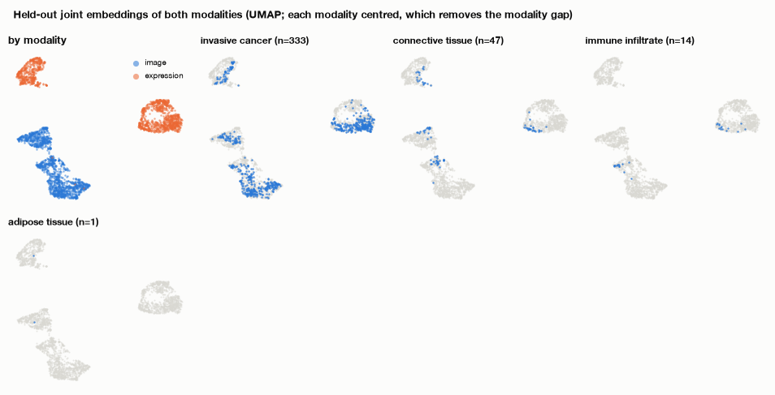
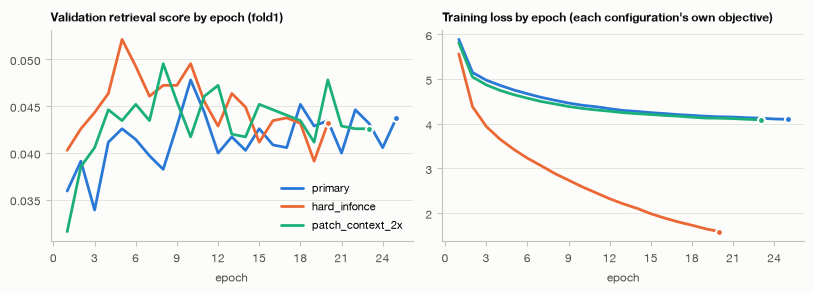

# Multimodal representation learning report

Objective: “Learn joint embeddings of tissue image patches and spot-level gene expression to enable cross-modal retrieval and prediction of gene expression from histology.” Data: <code>data/stimage_her2</code> · generated 2026-10-31 15:46 UTC · plan: llm · prose: LLM (claude-opus-5-5)

## Summary

The goal was to learn a joint embedding of histology spot patches and spot-level gene expression, to support image↔expression retrieval and prediction of expression from histology. The agent used grouped 4-fold cross-validation by patient and CLIP-style contrastive alignment, pairing a frozen **phikon** image encoder with an MLP trained from scratch on 100 expression PCs. After the critic's review, the hard-InfoNCE configuration replaced the soft-InfoNCE one as primary.

- **Retrieval works, at a low absolute level.** On held-out patients, the primary's mean recall@10 is **0.025 ± 0.002** (±1 SD over 4 folds). Chance is 0.003 and linear CCA reaches 0.012. The gain over CCA is +0.013 (SD 0.002) and holds in 4/4 folds.
- **Prediction ties ridge regression.** Mean Pearson r on the top-50 genes is 0.171 against 0.180 for ridge (difference −0.009, SD 0.037; better in 2/4 folds).
- **Label probes and clustering show no clear gain** over unimodal features or fusion baselines.
- **Patient effects dominate the embedding.** Held-out embeddings cluster more by patient (silhouette 0.40) than by tissue label (0.09).

Bottom line: contrastive integration clearly beats linear alignment for cross-modal retrieval. It does not beat a ridge model on frozen image features for expression prediction.

## Data and objective

**Data.** The record describes a spatial AnnData object with 13,620 spots. All spots have image patches and spatial coordinates; 13,619 have expression (11,871 genes). One spot lacks expression and was left out of alignment.

**What shaped the decisions:**
- **Strong patient structure.** Patient explains 77% of the variance of the top expression components, with a group silhouette of 0.634. There are 36 slides nested within 8 patients. Spots are not independent within a patient, so whole patients had to be held out.
- **Spatial autocorrelation.** Median Moran's I is 0.14. Spot spacing is 1.88× the spot diameter (145 px), which is why a larger-patch comparison was worth testing.
- **Near-duplicate expression profiles.** 23.2% of expression spots have a near-twin. Treating every other spot in a batch as a negative would therefore often create false negatives, which motivated soft InfoNCE.
- **Sparse counts.** The counts are integers, 83% zeros, with a median library size of 3,231. This motivated normalisation, log1p, selection of variable genes and PCA.
- **Stain and scanner differences.** 28% of the variance in mean patch colour lies between patients, which motivated Reinhard colour normalisation.
- **Sparse, imbalanced labels.** The tissue `label` has 6 classes on 3,157 spots (23%), with an imbalance ratio of 18.124: 1,758 invasive cancer versus 97 breast glands. The objective does not name the label, so it was used only for evaluation. Label variance share in expression is 0.158, far below the patient share.

## What the agent decided and why

- **Split:** grouped 4-fold CV by patient. Each fold tests 2 patients and holds out 1 patient for validation, leaving about 8.5k training pairs per fit; test sets have 3,184–3,561 spots. This was chosen because of the 77% patient variance share and the spatial autocorrelation. Note that patient D was the validation group in both fold 3 and fold 4.
- **Strategy:** contrastive alignment (CLIP-style), because the objective needs a shared space and about 8,511 training pairs are available.
- **Image encoder:** frozen phikon. Four candidates were screened on 2,000 training and 500 validation spots from separate patients. Phikon was best on every metric:
  - recall@10: 0.087 (next best 0.063);
  - ridge R²: 0.215 (next best 0.184);
  - probe F1: 0.432 (next best 0.39).
  
  PLIP, BiomedCLIP and DINOv2 were rejected. Fine-tuning was not tried, because none of the encoders is a pre-aligned dual encoder and a frozen backbone keeps variance low.
- **Expression encoder and preprocessing:**
  - an MLP trained from scratch;
  - library-size normalisation to the median, then log1p;
  - the 2,000 most variable genes, then PCA to 100 components, all fitted on training folds only.
- **Image preprocessing:** patches of 1.0× the spot diameter, so each patch covers the tissue the RNA came from, plus Reinhard colour normalisation.
- **Losses:** soft InfoNCE (because of the 23% near-twins) plus a cross-modal regression head (because the objective asks for prediction). No supervised cross-entropy, because the labels are evaluation-only.
- **Hyperparameters:**
  - 256-d embedding, 512 hidden units, dropout 0.1;
  - learning rate 0.001, batch size 512 (511 negatives per positive);
  - temperature learned, starting from 0.07;
  - early stopping with patience 15 and a 180 s cap per fit.
- **Comparisons:** two configurations tested the least certain choices. `hard_infonce` tested the soft-target choice; `patch_context_2x` tested the patch size.
- **Evaluation:** the primary metric is mean recall@10. Secondary metrics are top-50-gene Pearson against ridge and CCA, label probes and ARI against unimodal and fusion baselines, and patient silhouette.
- **Planner:** the LLM planner adopted the rule-based proposal unchanged.

### Configurations trained

| configuration | role | strategy | encoders | regime | losses | dim | lr | cap (s) |
|---|---|---|---|---|---|---|---|---|
| primary | primary | contrastive_alignment | image: phikon, expression: mlp | frozen, from_scratch | soft_infonce x 1.0, cross_modal_regression x 1.0 | 256 | 0.001 | 180 |
| hard_infonce | comparison | contrastive_alignment | image: phikon, expression: mlp | frozen, from_scratch | infonce x 1.0, cross_modal_regression x 1.0 | 256 | 0.001 | 135 |
| patch_context_2x | comparison | contrastive_alignment | image: phikon, expression: mlp | frozen, from_scratch | soft_infonce x 1.0, cross_modal_regression x 1.0 | 256 | 0.001 | 135 |

### Encoder screening (frozen features, training vs validation samples of fold 1)

| image | expression | cca_recall_at_10 | zero_shot_recall_at_10 | alignment_recall_at_10 | ridge_r2 | probe_macro_f1 |
|---|---|---|---|---|---|---|
| phikon | mlp | 0.087 | – | 0.087 | 0.215 | 0.432 |
| plip_image | mlp | 0.057 | – | 0.057 | 0.175 | 0.340 |
| biomedclip_image | mlp | 0.063 | – | 0.063 | 0.026 | 0.392 |
| dinov2_base | mlp | 0.063 | – | 0.063 | 0.184 | 0.351 |

## Results on held-out test data

All figures are on held-out patients: mean ± 1 SD over 4 folds.

**Retrieval (primary metric)**
- **Recall@10** across the full test fold:

| Method | Recall@10 | SD | Folds |
|---|---|---|---|
| hard_infonce (primary) | 0.025 | 0.002 | 0.0221–0.0278 |
| patch_context_2x | 0.021 | 0.002 | — |
| soft InfoNCE (original primary) | 0.020 | 0.004 | — |
| CCA | 0.012 | — | — |
| Chance | 0.003 | — | — |

- **Other ranks:** R@1 is 0.003 and R@5 is 0.014. The median partner rank is 577.5, against 1047.125 for CCA.
- **Smaller gallery:** with a gallery of 1,000 spots, recall@10 is 0.067 (CCA 0.034).
- **Both directions are similar:** image→expression 0.026 and expression→image 0.024.
- **Semantic retrieval is better than exact retrieval.** 60.4% of the top-10 neighbours share the query's tissue label (label_match 0.604), against 0.448 by chance and 0.531 for CCA. The embedding retrieves the right kind of tissue far more often than the exact partner spot.
- **Per-query examples (fold 1)** vary widely: partner ranks run from 16 to 1331.

**Cross-modal prediction (image → expression, top-50 genes)**
- The primary's regression head reaches mean r 0.171 (SD 0.013). Ridge reaches 0.180 (SD 0.045, folds 0.1309–0.2388), a statistical tie.
- kNN in the joint space is worse (0.144–0.164) than any regression head.
- The patch_context_2x head has the highest mean, 0.188 (SD 0.005), with 158.25 genes at r > 0.3 against 137.75 for ridge. This is a descriptive test-set observation, not a pre-specified comparison.
- Within-patient correlations are similar across methods: 0.143 for the primary and 0.146 for ridge. Mean r over all genes is 0.093 for both.
- The best-predicted genes in fold 1 include PTMS (r 0.726), COL3A1 (0.626) and MMP14 (0.616).

**Label probe (macro-F1, chance 0.167)**
- The primary's fused embedding reaches 0.297 (SD 0.113), which is above chance.
- It is below the unimodal baseline (0.341), early fusion (0.357) and late fusion (0.319), and above CCA (fused) at 0.258.
- None of these differences is clear, because SDs are 0.076–0.099 and wins range from 1/4 to 3/4 folds.

**Clustering (ARI)**
- The primary's fused embedding reaches 0.232 (SD 0.075), against 0.243 for unimodal (difference −0.011, SD 0.094) and 0.231 for CCA (difference +0.001, SD 0.112).
- patch_context_2x (fused) has the highest mean, 0.288 (SD 0.100).

*Test metrics for every configuration (blue: final configuration) and baseline (grey).*

### recall@10 (mean of both directions) (primary metric)

| representation | kind | mean | lower | upper | interval |
|---|---|---|---|---|---|
| hard_infonce | configuration | 0.025 | 0.023 | 0.027 | ±1 SD over 4 folds |
| patch_context_2x | configuration | 0.021 | 0.018 | 0.023 | ±1 SD over 4 folds |
| primary | configuration | 0.020 | 0.016 | 0.023 | ±1 SD over 4 folds |
| cca | baseline | 0.012 | 0.010 | 0.013 | ±1 SD over 4 folds |

### Retrieval

| representation | R@1 | R@5 | R@10 | image→expression R@10 | expression→image R@10 | median rank | chance R@10 | label match@10 | label chance |
|---|---|---|---|---|---|---|---|---|---|
| primary | 0.003 | 0.011 | 0.020 | 0.023 | 0.017 | 668.250 | 0.003 | 0.594 | 0.448 |
| hard_infonce | 0.003 | 0.014 | 0.025 | 0.026 | 0.024 | 577.500 | 0.003 | 0.604 | 0.448 |
| patch_context_2x | 0.003 | 0.011 | 0.021 | 0.021 | 0.020 | 684.875 | 0.003 | 0.589 | 0.448 |
| cca | 0.001 | 0.006 | 0.012 | 0.012 | 0.011 | 1047.125 | 0.003 | 0.531 | 0.448 |

### Cross-modal prediction

| method | mean r (top 50) | median r | within-group r | mean r (all) | features r > 0.3 |
|---|---|---|---|---|---|
| patch_context_2x:head | 0.188 | 0.175 | 0.144 | 0.099 | 158.2 |
| ridge | 0.180 | 0.186 | 0.146 | 0.093 | 137.8 |
| hard_infonce:head | 0.171 | 0.154 | 0.143 | 0.093 | 132.8 |
| primary:head | 0.168 | 0.162 | 0.144 | 0.092 | 134.8 |
| patch_context_2x:knn | 0.164 | 0.153 | 0.139 | 0.085 | 113.8 |
| primary:knn | 0.149 | 0.150 | 0.136 | 0.082 | 103.8 |
| hard_infonce:knn | 0.144 | 0.148 | 0.133 | 0.084 | 106.2 |

### Classification and clustering

| representation | view | probe macro-F1 | balanced acc. | kNN macro-F1 | ARI | NMI |
|---|---|---|---|---|---|---|
| patch_context_2x | fused | 0.368 | 0.535 | 0.396 | 0.288 | 0.336 |
| early_fusion | concat | 0.357 | 0.505 | – | – | – |
| patch_context_2x | image | 0.356 | 0.496 | 0.364 | 0.283 | 0.349 |
| cca | image | 0.342 | 0.465 | 0.335 | 0.179 | 0.276 |
| unimodal | image | 0.324 | 0.482 | 0.349 | 0.209 | 0.312 |
| late_fusion | average | 0.319 | 0.464 | – | – | – |
| primary | image | 0.307 | 0.466 | 0.322 | 0.201 | 0.300 |
| hard_infonce | image | 0.304 | 0.446 | 0.345 | 0.215 | 0.298 |
| hard_infonce | fused | 0.297 | 0.425 | 0.326 | 0.232 | 0.292 |
| primary | fused | 0.292 | 0.415 | 0.341 | 0.244 | 0.306 |
| cca | fused | 0.258 | 0.337 | 0.289 | 0.231 | 0.311 |
| unimodal | expression | 0.245 | 0.346 | 0.232 | 0.165 | 0.234 |
| primary | expression | 0.244 | 0.357 | 0.264 | 0.158 | 0.225 |
| hard_infonce | expression | 0.244 | 0.332 | 0.283 | 0.164 | 0.231 |
| patch_context_2x | expression | 0.239 | 0.347 | 0.271 | 0.154 | 0.220 |
| cca | expression | 0.229 | 0.355 | 0.197 | 0.129 | 0.221 |

### Embedding geometry

| representation | alignment | uniformity a | uniformity b | modality gap | eff. rank a | eff. rank b | group silhouette |
|---|---|---|---|---|---|---|---|
| primary | 1.361 | -1.956 | -1.683 | 0.654 | 129.663 | 135.116 | 0.413 |
| hard_infonce | 1.300 | -2.319 | -1.975 | 0.548 | 127.680 | 128.837 | 0.353 |
| patch_context_2x | 1.375 | -1.832 | -1.658 | 0.685 | 126.555 | 133.194 | 0.419 |
| cca | 1.754 | -3.163 | -2.755 | 0.466 | 57.815 | 58.000 | 0.265 |

## Did integration help?

- **Against linear alignment (CCA): yes, for retrieval.** Recall@10 is 0.025 against 0.012, a difference of +0.013 (SD 0.002) that holds in 4/4 folds. This is the clearest effect in the run and the gap is large relative to its spread. The validation data agree: the soft-InfoNCE primary beat CCA by +0.016 ± 0.008, also in 4/4 folds.
- **Against ridge regression for prediction: no.** The difference is −0.009 (SD 0.037), with the primary better in 2/4 folds. The range of the difference comfortably includes zero, so joint training adds nothing measurable over a linear map from frozen phikon features. The same tie appeared on validation (0.150 vs 0.152).
- **Against each modality alone and against fusion, for label probes: no clear gain.** The fused embedding's macro-F1 falls below the unimodal baseline (−0.044, SD 0.090, better in 1/4 folds), early fusion (−0.060, SD 0.088, 1/4) and late fusion (−0.022, SD 0.099, 2/4). The only positive difference is against CCA (+0.038, SD 0.076, 3/4), and it is not clear either. The image side carries most of the label signal: unimodal image features reach 0.324 and unimodal expression features 0.245.
- **Clustering: a tie** with unimodal features (−0.011) and with CCA (+0.001), with SDs of about 0.1.

Summary: the joint space is useful for cross-modal *retrieval*, where it clearly beats linear alignment. For predicting expression and for representing tissue type, it ties simpler methods; these ties are findings, not failures. Integration did not reduce patient effects: patient silhouette is 0.40, against 0.09 for label.

| metric | versus | final config | alternative | difference | SD | 95% interval | folds better | folds |
|---|---|---|---|---|---|---|---|---|
| retrieval_mean_recall_at_10 | cca | 0.025 | 0.012 | 0.013 | 0.002 | – | 4 | 4 |
| prediction_mean_pearson_top50 | ridge | 0.171 | 0.180 | -0.009 | 0.037 | – | 2 | 4 |
| probe_macro_f1 | unimodal | 0.297 | 0.341 | -0.044 | 0.090 | – | 1 | 4 |
| probe_macro_f1 | early_fusion | 0.297 | 0.357 | -0.060 | 0.088 | – | 1 | 4 |
| probe_macro_f1 | late_fusion | 0.297 | 0.319 | -0.022 | 0.099 | – | 2 | 4 |
| probe_macro_f1 | cca | 0.297 | 0.258 | 0.038 | 0.076 | – | 3 | 4 |
| clustering_ari | unimodal | 0.232 | 0.243 | -0.011 | 0.094 | – | 2 | 4 |
| clustering_ari | cca | 0.232 | 0.231 | 0.001 | 0.112 | – | 2 | 4 |

## Downstream analyses

*Held-out queries and their five nearest matches in the joint space.*

*Observed and predicted values of the best-predicted target features on one held-out group (z-scores within the group).*

*k-means clusters of held-out joint embeddings and their label composition.*

*Held-out joint embeddings of both modalities.*

*Validation score and training loss by epoch.*

Best-predicted target features (hard_infonce:head):

| feature | test r |
|---|---|
| PTMS | 0.726 |
| PCSK7 | 0.660 |
| AP000769.1 | 0.660 |
| KRT19 | 0.633 |
| COL3A1 | 0.626 |
| MMP14 | 0.616 |

## Critic review

**Triggers.** The critic reviewed validation results only and raised five informational triggers:
- no clear gain over ridge for prediction (−0.002, better in 2/4 folds);
- no clear gain over unimodal clustering (+0.039, 2/4);
- no clear gain over CCA clustering (+0.032, 3/4);
- two comparisons scoring higher on recall@10: hard_infonce (0.040 vs 0.034) and patch_context_2x (0.036 vs 0.034), both flagged automatically as "within noise".

**Assessment.** The critic judged that the primary works but scores low: validation recall@10 was 0.0335, about 6× its validation chance of about 0.0054. It argued against the "within noise" flag for hard InfoNCE. Hard InfoNCE beat the soft-target primary in every fold (+0.0043, +0.0041, +0.0084, +0.0101; mean +0.0067), and a paired t over the four folds was about 4.5. The critic called this small but consistent evidence against the soft-target choice. It also noted two things:
- best-epoch selection on validation makes all scores slightly optimistic, equally for both configurations;
- hard InfoNCE overfits faster, with best epochs between 3 and 10 overall.

**Revision.** The critic promoted `hard_infonce` to primary at no extra compute cost. The switch was **kept**: validation recall@10 rose from 0.0335 to 0.0403 (+0.0068, better in 4/4 folds).

**Test outcome.** On the test data, scored once after the critic, the ranking held: hard_infonce 0.025, patch_context_2x 0.021, soft InfoNCE 0.020. The soft-target rationale (23.2% near-twins) did not pay off here.

| trigger | severity | finding |
|---|---|---|
| no_clear_gain_over_ridge | info | No clear difference between the primary configuration and ridge on prediction_mean_pearson_top50 (mean difference -0.002; primary better in 2/4 folds). |
| no_clear_gain_over_unimodal | info | No clear difference between the primary configuration and unimodal on clustering_ari (mean difference +0.039; primary better in 2/4 folds). |
| no_clear_gain_over_cca | info | No clear difference between the primary configuration and cca on clustering_ari (mean difference +0.032; primary better in 3/4 folds). |
| comparison_better | info | Comparison 'hard_infonce' scores higher than the primary on retrieval_mean_recall_at_10 (0.040 vs 0.034); within noise. |
| comparison_better | info | Comparison 'patch_context_2x' scores higher than the primary on retrieval_mean_recall_at_10 (0.036 vs 0.034); within noise. |

## Limitations

- **Low absolute retrieval.** Recall@10 is 0.025 and the median rank is 577.5. Exact spot-level matching across patients is weak, even though it is well above chance (0.003) and CCA.
- **Batch confounding (warning flag).** Held-out embeddings group by patient (silhouette 0.40) far more than by tissue label (0.09). Colour normalisation was applied but no explicit batch correction, and patient explains 77% of the variance in expression.
- **Only 4 folds and 8 patients.** Each estimate rests on 4 held-out patient pairs. SDs over 4 folds are crude uncertainty measures, and no bootstrap intervals were computed. Probe and ARI SDs of about 0.1 make most of those comparisons uninformative.
- **Validation patient reused.** Patient D was the validation group in two folds. In 3 of 4 folds the validation patient is also tested in another fold, so model selection is not fully independent across folds.
- **Possible pretraining overlap.** Phikon was pretrained on TCGA tiles, not on these spot patches, but corpus overlap cannot be excluded. There was no zero-shot baseline, so overlap would make all phikon-based results, including ridge, slightly optimistic.
- **Optimistic validation scores.** Best-epoch selection made validation scores optimistic; test recall (0.025) is below validation (0.040). Training peaked early (epochs 3–10), which suggests limited signal for the trainable heads.
- **Post-hoc primary.** The primary was switched after looking at validation results. Comparisons were not re-pre-registered, though the test data were scored only once.
- **Promising variant not selected.** patch_context_2x had the best prediction (r 0.188) and the best probe and ARI means, but it was not the selected primary. Its advantage is not formally tested and should not be claimed from these test results.
- **Fixed hyperparameters.** Only one embedding size, learning rate and set of loss weights was tried, there was no fine-tuning, and each fit was capped at 180 s.
- **Small, imbalanced labelled set.** Labels cover only 23% of spots with an imbalance ratio of 18.124, which limits probe and clustering evaluation. Retrieval examples in fold 1 show 0 same-label hits in the top 5 for most queries.

## Number check

All 178 numbers in the prose above were found in the computed outputs.

## Reproducibility

- Command: `mmagent run --data data/stimage_her2 --objective 'Learn joint embeddings of tissue image patches and spot-level gene expression to enable cross-modal retrieval and prediction of gene expression from histology.' --out outputs/generated_report_1`
- Seed 774; device mps (Apple GPU (MPS) on arm64); projection heads on cpu.
- LLM: claude-opus-5-5 via the Claude CLI, 3 call(s), $0.55; prompts and replies in `llm_transcript.json`; `--replay outputs/generated_report_1` repeats them without calling a model.
- Embeddings: `embeddings/held_out_embeddings.npz` (4,882 held-out rows, subsampled, float16).
- Files: decision_log.json, plan.json/plan.md, profile.json, screening.json, evaluation.json, tables/, figures/, downstream/, methods_summary.md, model_summary.json, run_manifest.json.

## Appendix: training summaries

| configuration | fold | best epoch | epochs | stopped because | best val score | trainable params |
|---|---|---|---|---|---|---|
| primary | fold1 | 10 | 25 | no validation improvement for 15 epochs | 0.048 | 1,868,753 |
| primary | fold2 | 4 | 19 | no validation improvement for 15 epochs | 0.017 | 1,868,753 |
| primary | fold3 | 3 | 18 | no validation improvement for 15 epochs | 0.031 | 1,868,753 |
| primary | fold4 | 7 | 22 | no validation improvement for 15 epochs | 0.040 | 1,868,753 |
| hard_infonce | fold1 | 5 | 20 | no validation improvement for 15 epochs | 0.052 | 1,868,753 |
| hard_infonce | fold2 | 4 | 19 | no validation improvement for 15 epochs | 0.020 | 1,868,753 |
| hard_infonce | fold3 | 3 | 18 | no validation improvement for 15 epochs | 0.039 | 1,868,753 |
| hard_infonce | fold4 | 8 | 23 | no validation improvement for 15 epochs | 0.050 | 1,868,753 |
| patch_context_2x | fold1 | 8 | 23 | no validation improvement for 15 epochs | 0.050 | 1,868,753 |
| patch_context_2x | fold2 | 3 | 18 | no validation improvement for 15 epochs | 0.018 | 1,868,753 |
| patch_context_2x | fold3 | 3 | 18 | no validation improvement for 15 epochs | 0.035 | 1,868,753 |
| patch_context_2x | fold4 | 7 | 22 | no validation improvement for 15 epochs | 0.042 | 1,868,753 |
