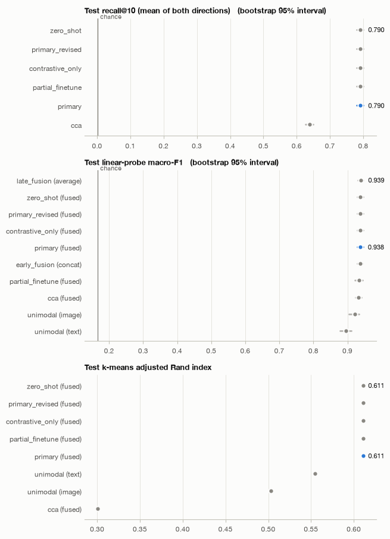
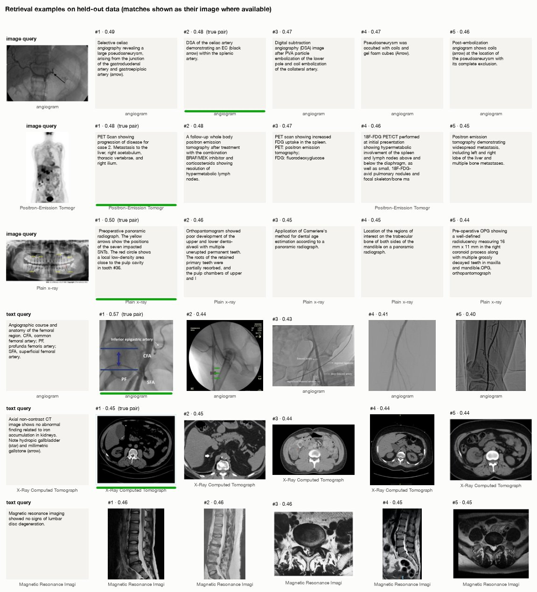
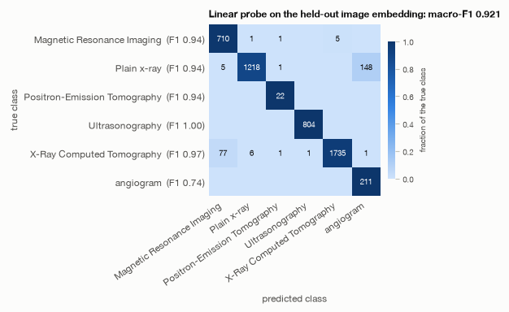
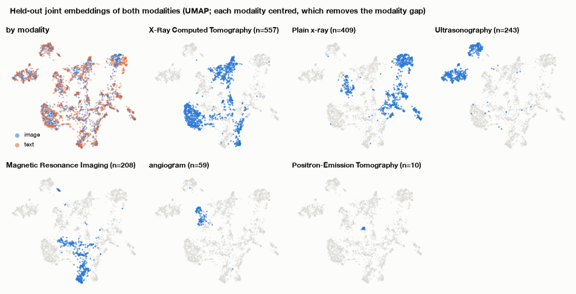
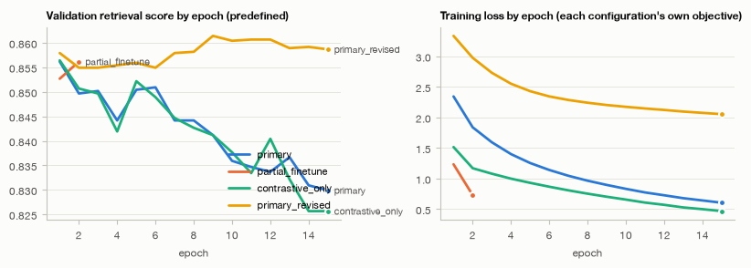

# Multimodal representation learning report

Objective: “Learn a joint image–caption embedding for image–text retrieval and imaging-modality classification.” Data: <code>data/rocov2</code> · generated 2026-10-31 17:30 UTC · plan: llm · prose: LLM (claude-opus-5-5)

## Summary

The goal was a joint image–caption embedding for image–text retrieval (the primary task) and classification of imaging modality into 6 classes. The agent used the predefined split (20,000 train / 1,999 validation / 5,000 test), frozen BiomedCLIP image and text encoders, and residual 512-d projection heads trained with InfoNCE plus a supervised cross-entropy (CE) term at weight 0.5.

**Training added nothing.** Every trained configuration chose epoch 0, the identity starting point of the residual heads. So the "learned" model is the pretrained (zero-shot) BiomedCLIP space. This held for the primary model, the contrastive-only model, partial fine-tuning and the critic's lower-learning-rate revision.

**Retrieval.** On the held-out test set, mean R@10 was 0.7902 (bootstrap 95% interval 0.7795–0.8001), against a chance level of 0.002. This is +0.1517 over CCA (95% CI 0.141–0.162) and exactly equal to zero-shot (difference 0.000, CI 0.000 to 0.000).

**Classification.** A linear probe on the fused embedding reached macro-F1 0.938 (0.930–0.946), against a chance level of 0.167. That beats the image-only features by 0.017 (CI 0.005–0.033) but ties simple early fusion (difference 0.000, CI −0.003 to 0.004) and late fusion (difference −0.001, CI −0.004 to 0.002).

**Bottom line:** pretrained BiomedCLIP is a strong solution here. Fusing the two modalities helps classification compared with one modality alone. The training in this run did not improve on either. The absolute scores may also be inflated, because BiomedCLIP's pretraining data may overlap this dataset.

## Data and objective

**Size and pairing.** 27,000 samples; 26,999 have both an image and a caption, and the 1 incomplete sample was dropped from alignment. With about 19,999 training pairs, contrastive alignment is feasible, and a batch of 512 gives 511 negatives per positive.

**Label.** `modality` has 6 classes and is present on 99.1% of samples (26,756). It is strongly imbalanced (imbalance ratio 63.857):
- X-Ray Computed Tomography: 9,387
- Plain x-ray: 7,449
- Positron-Emission Tomography (PET): 147

Because of this, macro-F1 is the sensitive metric, and the agent cited it as the reason for adding the supervised CE term.

**Images.** 70% are greyscale (0.704), so luminance was copied to three channels to fit the pretrained encoders. There were no near-duplicate images (0.0).

**Captions.** Short: median 17 words, 95% have 49 words or fewer, and 2.6% exceed 60 words. Vocabulary is 17,825 distinct words, and about 1% of captions are near-duplicates (0.009963). This drove the choice of text truncation length.

**Groups and split.**
- There are 21,341 `article` groups, and the data come with a predefined 20,000 / 2,000 / 5,000 split.
- That split is **not grouped by article** ("Test groups: none (not grouped)").
- 19% of test samples share an article with a validation sample, so choices made on validation may flatter test results slightly.
- How many articles train and test share is not reported.

**Domain.** The captions are figure captions grouped by article. That is the same kind of material as BiomedCLIP's PMC-15M pretraining corpus, which raises a contamination concern.

## What the agent decided and why

- **Split:** the predefined split was used so results are comparable with other work and the test set stays unseen. Models were selected on validation only, and the test set was scored once, after the critic. The cost: there is only one fold, so uncertainty comes from bootstrap intervals rather than spread across folds. The 19% validation–test article overlap was noted.
- **Strategy:** CLIP-style contrastive alignment (InfoNCE). The objective needs a shared space, and there are about 19,999 training pairs.
- **Encoders:** 4 image × 4 text candidates were screened on 2,000 training and 500 validation samples drawn from separate groups.
  - BiomedCLIP image + text scored alignment R@10 0.966 (zero-shot; 0.917 with CCA).
  - The next best pair, BiomedCLIP image + PubMedBERT, scored 0.599. DINOv2 + BiomedCLIP text scored 0.511.
  - For images, BiomedCLIP's probe macro-F1 (0.934) led DINOv2 (0.914), CLIP-B/16 (0.915) and ResNet-50 (0.895 at best).
  - The agent later warned that BiomedCLIP's advantage may be inflated by overlap with its pretraining data.
- **Preprocessing:**
  - Greyscale images were copied to RGB.
  - The text cap was raised by the LLM planner from 80 to 128 tokens. Biomedical words split into more subword tokens, and features are computed once, so the longer cap costs almost nothing.
- **Heads:** residual 512-d heads that start as the identity, so training begins from the zero-shot solution and epoch 0 can itself be selected. The rule-based log said "embed 256"; the LLM corrected this to 512 to keep the pretrained dimension.
- **Training settings:**
  - lr 0.001, batch 512, dropout 0.1.
  - Temperature learned, starting from 0.07.
  - Early stopping with patience 15, and a 180 s cap per fit.
- **Losses:** InfoNCE (weight 1.0) plus CE on `modality` (weight 0.5), since the objective asks for classification. A `contrastive_only` comparison tests whether the CE term costs retrieval.
- **Regime:** backbones frozen, which means few trainable parameters and low variance. Partial fine-tuning of the last 2 blocks was run as a comparison, with a 1,200 s budget and batch size raised from 64 to 128. The larger batch keeps the number of negatives from being confounded with fine-tuning.
- **Evaluation:** the primary metric is mean R@10 for retrieval. Baselines: each modality alone, CCA, early fusion, late fusion, zero-shot and chance. The zero-shot baseline is kept but flagged as possibly optimistic.

### Configurations trained

| configuration | role | strategy | encoders | regime | losses | dim | lr | cap (s) |
|---|---|---|---|---|---|---|---|---|
| primary | primary | contrastive_alignment | image: biomedclip_image, text: biomedclip_text | frozen, frozen | infonce x 1.0, supervised_ce x 0.5 | 512 | 0.001 | 180 |
| partial_finetune | comparison | contrastive_alignment | image: biomedclip_image, text: biomedclip_text | partial_finetune (last 2 blocks), partial_finetune (last 2 blocks) | infonce x 1.0, supervised_ce x 0.5 | 512 | 0.001 | 1,200 |
| contrastive_only | comparison | contrastive_alignment | image: biomedclip_image, text: biomedclip_text | frozen, frozen | infonce x 1.0 | 512 | 0.001 | 180 |
| primary_revised | primary | contrastive_alignment | image: biomedclip_image, text: biomedclip_text | frozen, frozen | infonce x 1.0, supervised_ce x 0.5 | 512 | 3e-05 | 180 |

### Encoder screening (frozen features, training vs validation samples of fold 1)

| image | text | cca_recall_at_10 | zero_shot_recall_at_10 | alignment_recall_at_10 | probe_macro_f1 |
|---|---|---|---|---|---|
| biomedclip_image | biomedclip_text | 0.917 | 0.966 | 0.966 | 0.934 |
| biomedclip_image | pubmedbert | 0.599 | – | 0.599 | 0.934 |
| biomedclip_image | clip_b16_text | 0.595 | – | 0.595 | 0.934 |
| biomedclip_image | minilm | 0.550 | – | 0.550 | 0.934 |
| dinov2_base | biomedclip_text | 0.511 | – | 0.511 | 0.914 |
| dinov2_base | pubmedbert | 0.328 | – | 0.328 | 0.914 |
| dinov2_base | clip_b16_text | 0.298 | – | 0.298 | 0.914 |
| dinov2_base | minilm | 0.255 | – | 0.255 | 0.914 |
| clip_b16_image | biomedclip_text | 0.579 | – | 0.579 | 0.915 |
| clip_b16_image | pubmedbert | 0.379 | – | 0.379 | 0.915 |
| clip_b16_image | clip_b16_text | 0.377 | 0.375 | 0.377 | 0.915 |
| clip_b16_image | minilm | 0.291 | – | 0.291 | 0.915 |
| resnet50 | biomedclip_text | 0.443 | – | 0.443 | 0.895 |
| resnet50 | pubmedbert | 0.272 | – | 0.272 | 0.727 |
| resnet50 | clip_b16_text | 0.250 | – | 0.250 | 0.727 |
| resnet50 | minilm | 0.233 | – | 0.233 | 0.727 |

## Results on held-out test data

**Retrieval (test, 5,000 pairs)**
- **Primary model (= zero-shot):**
  - Mean R@10 0.7902 (0.7795–0.8001), far above the chance level of 0.002.
  - R@1 0.3827, R@5 0.6804, median rank 2.0.
  - Both directions are similar: image→text 0.789, text→image 0.7914.
  - On a standardised gallery of 1,000, R@10 is 0.941.
- **CCA:** R@10 0.6385 (0.6255–0.6502), median rank 5.0, gallery-1,000 R@10 0.8564. The primary model beats CCA by 0.1517 (CI 0.141–0.162); the interval excludes zero.
- **Validation to test:** validation R@10 was 0.871. Test is lower (0.7902), most likely partly because the test gallery is larger, which makes R@10 harder.
- **Label consistency:** 0.939 of the top-10 neighbours share the query's modality, against a chance level of 0.262 (CCA: 0.821).

**Classification (linear probe macro-F1; chance level 0.167)**
- Fused embedding: 0.938 (0.930–0.946).
- Image view: 0.921 (0.904–0.935).
- Text view: 0.893 (0.875–0.909).
- The text view sits slightly below the unimodal text baseline (0.896), with heavily overlapping intervals.
- Detailed results for the image view: balanced accuracy 0.972, macro-F1 0.921.
  - Per-class F1 is high for Ultrasonography (0.999), CT (0.974), MRI (0.941), Plain x-ray (0.938) and even PET (0.936), despite PET having only 147 samples.
  - Angiogram is the clear weak class (0.739).

**Clustering (ARI; point estimates only, no intervals)**
- Test: fused 0.611, against text-only 0.555, image-only 0.503 and CCA fused 0.301.
- Validation reverses part of this: primary 0.508 against the unimodal baseline's 0.512 (difference −0.004).
- With no intervals and one fold, the test-set clustering advantage should be treated as unconfirmed.

**Configurations compared**
- `primary`, `contrastive_only`, `primary_revised` and `zero_shot` produced identical test metrics.
- `partial_finetune` differed only negligibly: R@1 0.3828 and fused probe 0.934.
- So neither the CE term nor fine-tuning changed anything measurable. None of these comparisons tells us whether CE or fine-tuning *would* help if training had moved the heads away from the identity starting point.

*Test metrics for every configuration (blue: final configuration) and baseline (grey).*

### recall@10 (mean of both directions) (primary metric)

| representation | kind | mean | lower | upper | interval |
|---|---|---|---|---|---|
| primary | configuration | 0.790 | 0.780 | 0.800 | bootstrap 95% interval |
| partial_finetune | configuration | 0.790 | 0.780 | 0.800 | bootstrap 95% interval |
| contrastive_only | configuration | 0.790 | 0.780 | 0.800 | bootstrap 95% interval |
| primary_revised | configuration | 0.790 | 0.780 | 0.800 | bootstrap 95% interval |
| zero_shot | baseline | 0.790 | 0.780 | 0.800 | bootstrap 95% interval |
| cca | baseline | 0.639 | 0.625 | 0.650 | bootstrap 95% interval |

### Retrieval

| representation | R@1 | R@5 | R@10 | image→text R@10 | text→image R@10 | median rank | chance R@10 | label match@10 | label chance |
|---|---|---|---|---|---|---|---|---|---|
| primary | 0.383 | 0.680 | 0.790 | 0.789 | 0.791 | 2.000 | 0.002 | 0.939 | 0.262 |
| partial_finetune | 0.383 | 0.680 | 0.790 | 0.789 | 0.791 | 2.000 | 0.002 | 0.939 | 0.262 |
| contrastive_only | 0.383 | 0.680 | 0.790 | 0.789 | 0.791 | 2.000 | 0.002 | 0.939 | 0.262 |
| primary_revised | 0.383 | 0.680 | 0.790 | 0.789 | 0.791 | 2.000 | 0.002 | 0.939 | 0.262 |
| cca | 0.269 | 0.519 | 0.639 | 0.634 | 0.643 | 5.000 | 0.002 | 0.821 | 0.262 |
| zero_shot | 0.383 | 0.680 | 0.790 | 0.789 | 0.791 | 2.000 | 0.002 | 0.939 | 0.262 |

### Classification and clustering

| representation | view | probe macro-F1 | balanced acc. | kNN macro-F1 | ARI | NMI |
|---|---|---|---|---|---|---|
| late_fusion | average | 0.939 | 0.975 | – | – | – |
| primary | fused | 0.938 | 0.975 | 0.950 | 0.611 | 0.760 |
| contrastive_only | fused | 0.938 | 0.975 | 0.950 | 0.611 | 0.760 |
| primary_revised | fused | 0.938 | 0.975 | 0.950 | 0.611 | 0.760 |
| zero_shot | fused | 0.938 | 0.975 | 0.950 | 0.611 | 0.760 |
| early_fusion | concat | 0.937 | 0.974 | – | – | – |
| partial_finetune | fused | 0.934 | 0.975 | 0.950 | 0.611 | 0.760 |
| cca | fused | 0.932 | 0.972 | 0.914 | 0.301 | 0.507 |
| cca | image | 0.929 | 0.973 | 0.925 | 0.173 | 0.347 |
| primary | image | 0.921 | 0.972 | 0.948 | 0.503 | 0.666 |
| contrastive_only | image | 0.921 | 0.972 | 0.948 | 0.503 | 0.666 |
| primary_revised | image | 0.921 | 0.972 | 0.948 | 0.503 | 0.666 |
| partial_finetune | image | 0.921 | 0.972 | 0.948 | 0.503 | 0.666 |
| unimodal | image | 0.921 | 0.972 | 0.948 | 0.503 | 0.666 |
| zero_shot | image | 0.921 | 0.972 | 0.948 | 0.503 | 0.666 |
| cca | text | 0.896 | 0.950 | 0.851 | 0.138 | 0.173 |
| unimodal | text | 0.896 | 0.950 | 0.877 | 0.555 | 0.672 |
| zero_shot | text | 0.896 | 0.950 | 0.877 | 0.555 | 0.672 |
| primary | text | 0.893 | 0.950 | 0.877 | 0.555 | 0.672 |
| partial_finetune | text | 0.893 | 0.950 | 0.877 | 0.555 | 0.672 |
| contrastive_only | text | 0.893 | 0.950 | 0.877 | 0.555 | 0.672 |
| primary_revised | text | 0.893 | 0.950 | 0.877 | 0.555 | 0.672 |

### Embedding geometry

| representation | alignment | uniformity a | uniformity b | modality gap | eff. rank a | eff. rank b | group silhouette |
|---|---|---|---|---|---|---|---|
| primary | 1.093 | -2.259 | -1.868 | 0.797 | 103.315 | 102.089 | – |
| partial_finetune | 1.093 | -2.259 | -1.868 | 0.797 | 103.306 | 102.068 | – |
| contrastive_only | 1.093 | -2.259 | -1.868 | 0.797 | 103.315 | 102.089 | – |
| primary_revised | 1.093 | -2.259 | -1.868 | 0.797 | 103.315 | 102.089 | – |
| cca | 0.937 | -3.829 | -3.837 | 0.030 | 63.539 | 63.714 | – |
| zero_shot | 1.093 | -2.259 | -1.868 | 0.797 | 103.315 | 102.089 | – |

## Did integration help?

**Two modalities against one: yes, for classification.**
- Fused macro-F1 0.938 against image-only 0.921: difference +0.017, CI 0.005–0.033, which excludes zero.
- Text-only is lower still (0.896).
- Test clustering ARI also favours fusion (0.611 against 0.555; difference 0.056), but there is no interval and validation showed no gain (−0.004).

**Against linear alignment (CCA): yes, clearly.**
- Retrieval R@10 +0.1517 (CI 0.141–0.162).
- Probe macro-F1 +0.005 (CI 0.002–0.008): small but excludes zero.
- ARI 0.611 against 0.301.
- Caveat: CCA was fit on the BiomedCLIP features, so this gap reflects the pretrained contrastive alignment against a linear re-alignment of the same features.

**Against simple fusion of unimodal features: tie.**
- Early fusion (concatenation): difference +0.000 (CI −0.003 to 0.004).
- Late fusion (averaging): difference −0.001 (CI −0.004 to 0.002).
- Both intervals include zero.

**Against zero-shot BiomedCLIP: identical.** Differences were exactly 0.000 on retrieval, probe and ARI.

**Interpretation.** The benefit comes from combining the image and caption information that the pretrained BiomedCLIP encoders already extract. Plain concatenation or averaging captures it just as well. The joint heads trained in this run added nothing, because the selected checkpoint is the untrained identity. Tying simpler methods is the finding.

| metric | versus | final config | alternative | difference | SD | 95% interval | folds better | folds |
|---|---|---|---|---|---|---|---|---|
| retrieval_mean_recall_at_10 | cca | 0.790 | 0.638 | 0.152 | – | 0.141 to 0.162 | 1 | 1 |
| retrieval_mean_recall_at_10 | zero_shot | 0.790 | 0.790 | 0.000 | – | 0.000 to 0.000 | 0 | 1 |
| probe_macro_f1 | unimodal | 0.938 | 0.921 | 0.017 | – | 0.005 to 0.033 | 1 | 1 |
| probe_macro_f1 | early_fusion | 0.938 | 0.937 | 0.000 | – | -0.003 to 0.004 | 1 | 1 |
| probe_macro_f1 | late_fusion | 0.938 | 0.939 | -0.001 | – | -0.004 to 0.002 | 0 | 1 |
| probe_macro_f1 | cca | 0.938 | 0.932 | 0.005 | – | 0.002 to 0.008 | 1 | 1 |
| probe_macro_f1 | zero_shot | 0.938 | 0.938 | 0.000 | – | 0.000 to 0.000 | 0 | 1 |
| clustering_ari | unimodal | 0.611 | 0.555 | 0.056 | – | – | 1 | 1 |
| clustering_ari | cca | 0.611 | 0.301 | 0.310 | – | – | 1 | 1 |
| clustering_ari | zero_shot | 0.611 | 0.611 | 0.000 | – | – | 0 | 1 |

## Downstream analyses

*Held-out queries and their five nearest matches in the joint space.*

*Confusion matrix of the linear probe (rows: true class).*

*Held-out joint embeddings of both modalities.*

*Validation score and training loss by epoch.*

## Critic review

**Triggers.** Three informational flags fired on validation:
- no gain over zero-shot on R@10 (difference +0.000, CI 0.000 to 0.000);
- no gain over the unimodal baseline on ARI (−0.004);
- no gain over zero-shot on ARI (+0.000).

**Assessment.** Retrieval is strong in absolute terms (validation R@10 0.871 against a chance level of 0.005, and +0.111 over CCA with CI 0.098–0.124). However, every configuration selected epoch 0, so "training contributed nothing."

**Diagnosis.** Training was moving the heads too far, too fast:
- Validation R@10 fell right after the first epoch (0.871 → 0.856 → 0.830) while training loss fell steadily (2.34 → 0.60).
- The same happened in `contrastive_only`, so the CE term was not the cause.
- Partial fine-tuning also degraded (0.853 after one epoch).
- The critic attributed this to lr 1e-3 pushing the heads away from an already well-aligned space, on data likely close to BiomedCLIP's PMC pretraining distribution.

**Revision.** It ran with lr 3e-05 and weight decay 0.01. It again chose epoch 0: validation R@10 0.8707 revised against 0.8707 original (difference +0.0000). It was **discarded**, and the original (zero-shot-equivalent) result stands. Test data were scored only after this decision.

| trigger | severity | finding |
|---|---|---|
| no_clear_gain_over_zero_shot | info | No clear difference between the primary configuration and zero_shot on retrieval_mean_recall_at_10 (difference +0.000, 95% CI +0.000 to +0.000). |
| no_clear_gain_over_unimodal | info | No clear difference between the primary configuration and unimodal on clustering_ari (mean difference -0.004; primary better in 0/1 folds). |
| no_clear_gain_over_zero_shot | info | No clear difference between the primary configuration and zero_shot on clustering_ari (mean difference +0.000; primary better in 0/1 folds). |

## Limitations

- **Possible pretraining contamination.** BiomedCLIP was pretrained on PMC-15M figure–caption pairs, and this dataset is figure captions grouped by article. Overlap would inflate the zero-shot/primary scores (screening 0.966, test 0.7902) and the margin over non-BiomedCLIP encoders and CCA. The run cannot rule this out.
- **No learned contribution.** All configurations selected epoch 0, including at lr 3e-05. The run therefore evaluates pretrained BiomedCLIP, not a trained joint model. Whether a smaller intervention, such as tuning only the temperature or using even lower learning rates, could help remains untested.
- **The CE term and fine-tuning are uninformative.** Because every model sits at the identity, the comparisons with `contrastive_only` and `partial_finetune` cannot answer their intended questions. Partial fine-tuning also ran only 2 epochs.
- **Single fold.** There is only one predefined split. Uncertainty comes from bootstrap intervals over test samples, not across folds. Clustering ARI has no interval at all.
- **Split not grouped by article.** 19% of test samples share an article with a validation sample. Train–test article overlap is not reported. Both could make held-out estimates optimistic.
- **Clustering is inconsistent.** The fused ARI advantage on test (0.611 against 0.555) was not seen on validation (0.508 against 0.512).
- **Gallery size.** R@10 depends on gallery size: chance is 0.002 on test and 0.005 on validation. Compare across studies using the gallery-1,000 figure (0.941) or with matched galleries.
- **Weak class and small class.** Angiogram F1 is only 0.739. PET has 147 samples in total, so its per-class F1 (0.936) rests on few test cases.
- **Screening sample.** Encoders were chosen on a 2,000/500 subsample. That was adequate here given the large margin, but it is still a small sample.

## Number check

1 of 198 numbers in the prose were **not found** in the computed outputs; treat them with caution:

- 50 (decisions_explained): ...F1 (0.934) led DINOv2 (0.914), CLIP-B/16 (0.915) and ResNet-50 (0.895 at best).   - The agen...

## Reproducibility

- Command: `mmagent run --data data/rocov2 --objective 'Learn a joint image–caption embedding for image–text retrieval and imaging-modality classification.' --out outputs/generated_report_2`
- Seed 774; device mps (Apple GPU (MPS) on arm64); projection heads on cpu.
- LLM: claude-opus-5-5 via the Claude CLI, 3 call(s), $0.71; prompts and replies in `llm_transcript.json`; `--replay outputs/generated_report_2` repeats them without calling a model.
- Embeddings: `embeddings/held_out_embeddings.npz` (2,441 held-out rows, subsampled, float16).
- Files: decision_log.json, plan.json/plan.md, profile.json, screening.json, evaluation.json, tables/, figures/, downstream/, methods_summary.md, model_summary.json, run_manifest.json.

## Appendix: training summaries

| configuration | fold | best epoch | epochs | stopped because | best val score | trainable params |
|---|---|---|---|---|---|---|
| primary | predefined | 0 | 15 | no validation improvement for 15 epochs | 0.871 | 1,055,751 |
| partial_finetune | predefined | 0 | 2 | no validation improvement for 2 epochs | 0.871 | 30,621,191 |
| contrastive_only | predefined | 0 | 15 | no validation improvement for 15 epochs | 0.871 | 1,052,673 |
| primary_revised | predefined | 0 | 15 | no validation improvement for 15 epochs | 0.871 | 1,055,751 |
